# Visualização passo a passo

Este documento mostra, por imagens, o caminho de três textos pelo `vigenere.py`: **higienização**,
**cifra com a senha `segredo`** e **quebra sem a senha**. Os casos são:

| Caso | Texto | Letras | A quebra funciona? |
|---|---|---|---|
| A | `Aye Mak Sicur` | 11 | ✘ |
| B | `G.D.M. IS ONLINE` | 11 | ✘ |
| C | *Dom Casmurro* inteiro | 308 887 | ✔ |

Todas as imagens são geradas pelo script [`gerar_imagens.py`](gerar_imagens.py), que chama as
funções do próprio `vigenere.py`. Os números que aparecem nelas (IC, χ², letras cifradas) são os que
o programa calcula. A teoria por trás de cada passo está em [`TEORIA.md`](TEORIA.md) e o código em
[`ANALISE.md`](ANALISE.md).

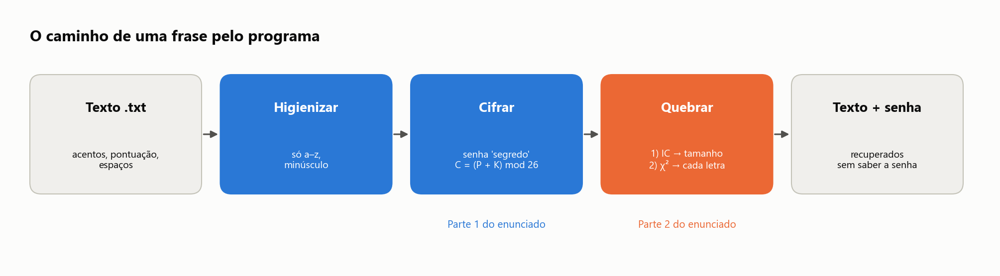

---

## 1. Higienização

`higienizar()` faz três coisas: passa tudo para minúsculas, aplica a normalização **NFD** (que separa
o acento da letra) e descarta tudo o que não for de `a` a `z`.

### Caso A: `Aye Mak Sicur`

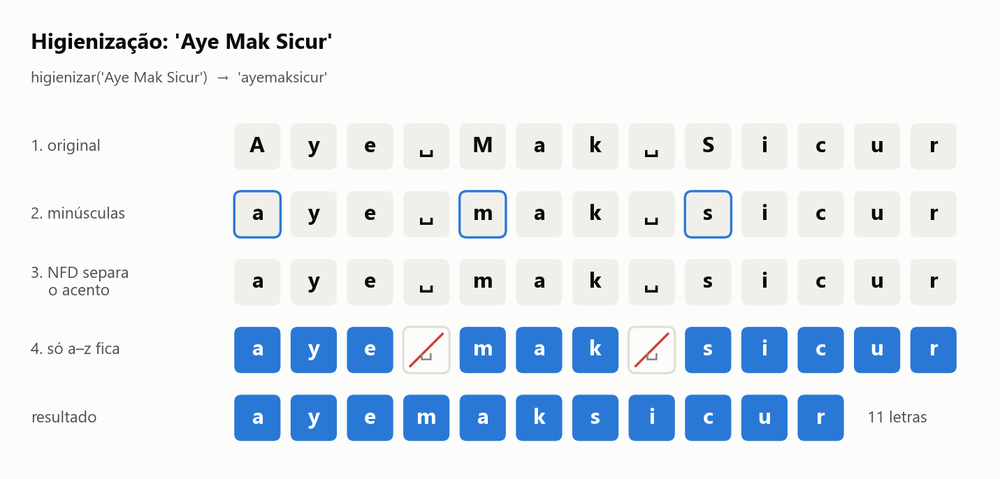

Não há acentos. Saem os espaços e as maiúsculas viram minúsculas: **`ayemaksicur`**.

### Caso B: `G.D.M. IS ONLINE`

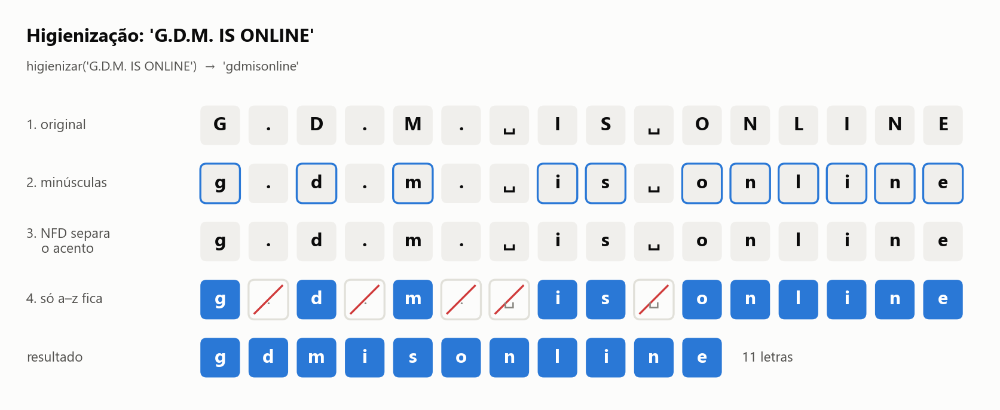

Os pontos e os espaços são descartados: **`gdmisonline`**.

### Caso C: trecho de *Dom Casmurro*

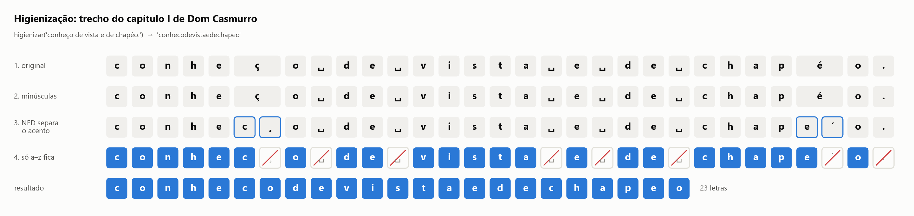

Neste caso o NFD tem trabalho a fazer: `ç` vira `c` + `¸` e `é` vira `e` + `´`. Os acentos soltos
não são letras de `a` a `z` e são descartados junto com a pontuação, então a letra base é mantida.
O trecho (com a grafia original do livro, "chapéo") vira **`conhecodevistaedechapeo`**.

---

## 2. Cifra com a senha `segredo`

Cada letra vira um número (a = 0 … z = 25), a senha se repete por baixo do texto e cada par é somado:
`C = (P + K) mod 26`. As cores marcam **qual letra da senha** foi usada em cada posição. A mesma cor
indica o mesmo deslocamento, e isso é o que o ataque vai explorar.

### Caso A

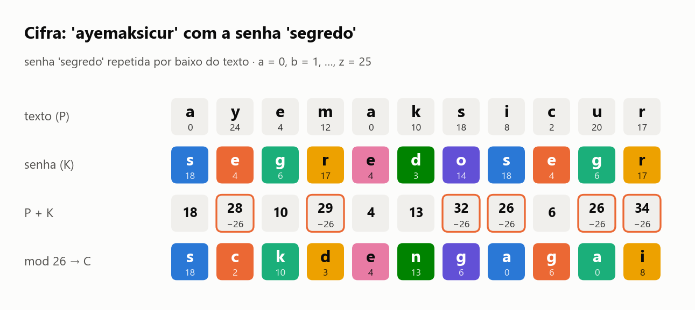

`ayemaksicur` → **`sckdengagai`**. As caixas com borda laranja passaram de 25 e deram a volta no
alfabeto. Os dois `a` do texto viraram `s` e `e`, porque cada um caiu sob uma letra diferente da
senha.

### Caso B

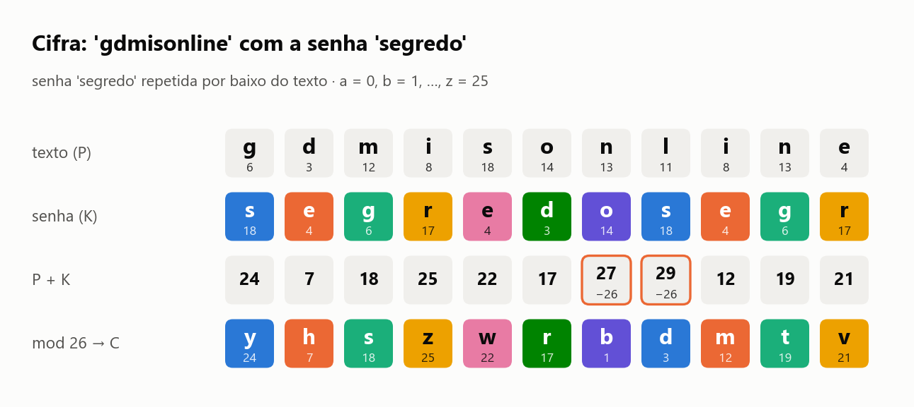

`gdmisonline` → **`yhszwrbdmtv`**, o mesmo resultado da tabela do [`RESUMO.md`](../RESUMO.md).

### Caso C

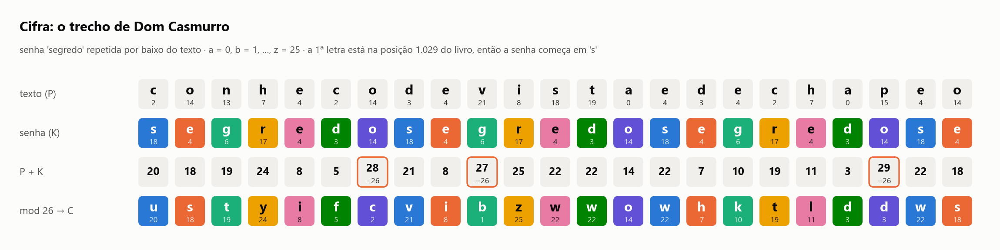

O livro inteiro é cifrado de uma vez, então a senha que cai sobre o trecho depende da **posição** dele
no texto. A primeira letra está na posição 1 029, e 1 029 é múltiplo de 7, por isso a senha começa
em `s`. O script confere que esse trecho é idêntico ao pedaço correspondente do livro cifrado.

---

## 3. Quebra, etapa 1: tamanho da senha (Índice de Coincidência)

Para testar um tamanho *k*, o texto cifrado é escrito em linhas de *k* letras. Se *k* for o tamanho
certo, cada coluna foi cifrada com **uma só letra da senha**, ou seja, cada coluna é uma cifra de César.

### Como ficam as colunas com k = 7

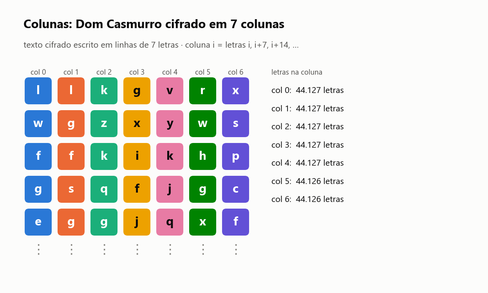

Em *Dom Casmurro* cada coluna tem cerca de **44 mil letras**: é uma amostra grande de português,
apenas deslocada.

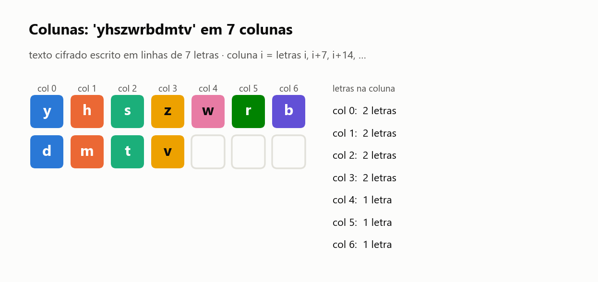

Em `yhszwrbdmtv` a senha mal chega a se repetir. Cada coluna tem **1 ou 2 letras**, e com isso não
há estatística possível. O caso A (`sckdengagai`) fica igual, também com 11 letras:

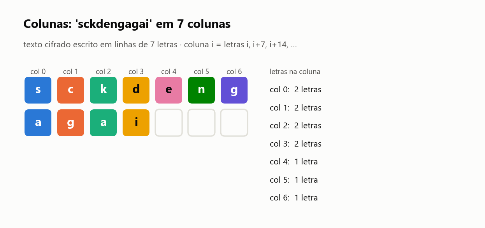

### O IC de cada tamanho

O programa calcula o IC médio das colunas para k = 1 … 10 e escolhe o **menor k que chega a 90% do
melhor IC** (linha laranja).

**Caso C: funciona.**

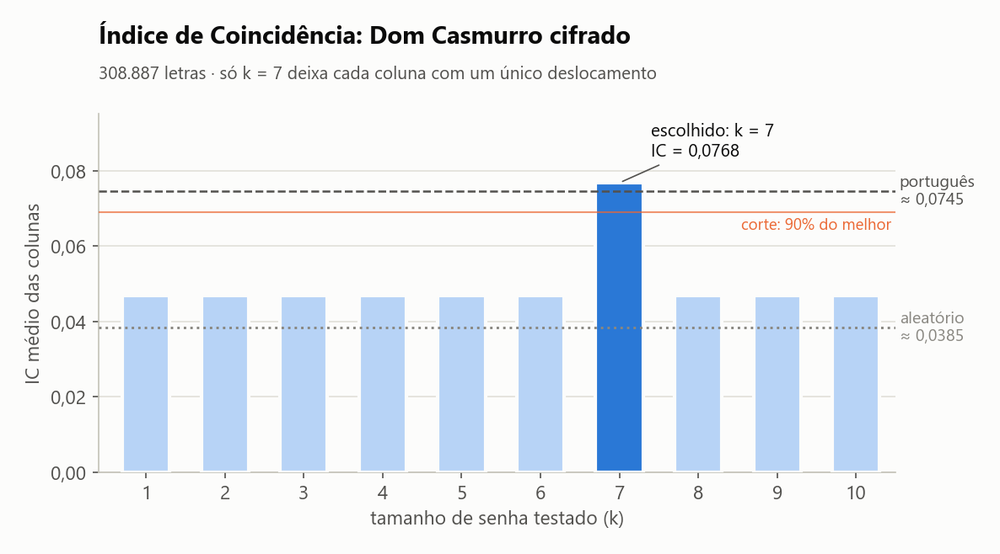

Só em k = 7 o IC (0,0768) chega ao do português (~0,0745). Nos outros tamanhos cada coluna mistura
sete deslocamentos e o IC cai para perto do aleatório.

**Caso A: falso positivo.**

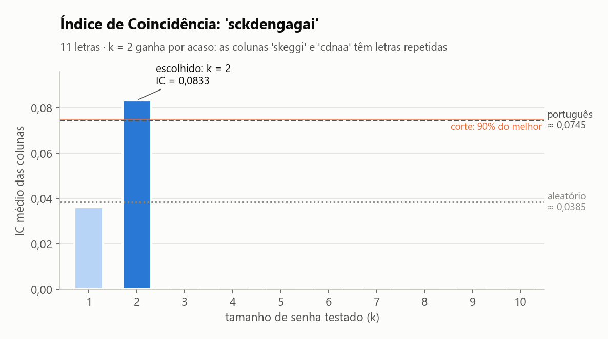

Com k = 2 as colunas são `skeggi` e `cdnaa`. Elas têm `gg` e `aa` repetidos **por acaso**, e com
tão poucas letras uma única repetição já dá um IC de 0,0833, maior que o do português. O programa
escolhe k = 2, que está errado.

**Caso B: sem informação.**

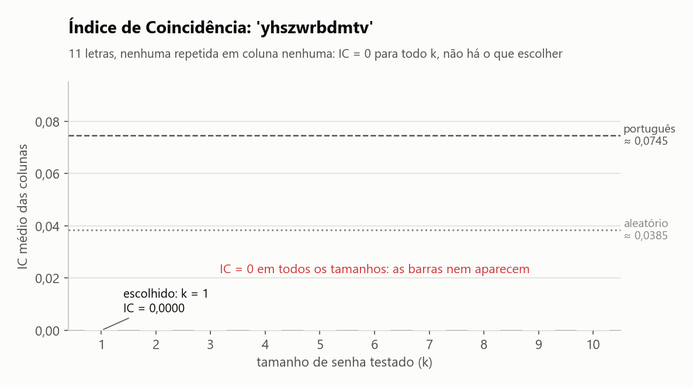

Nenhuma coluna, em nenhum tamanho, tem letra repetida, então o IC dá **zero para todo k**. Sem
diferença entre os tamanhos, o programa fica com o primeiro, k = 1.

---

## 4. Quebra, etapa 2: cada letra da senha (frequência e χ²)

Com o tamanho escolhido, cada coluna é uma cifra de César. O programa testa os 26 deslocamentos e
fica com o que deixa a coluna **mais parecida com o português**, medido pelo qui-quadrado (χ²,
quanto menor, mais parecido).

### A ideia, na coluna 0 de *Dom Casmurro*

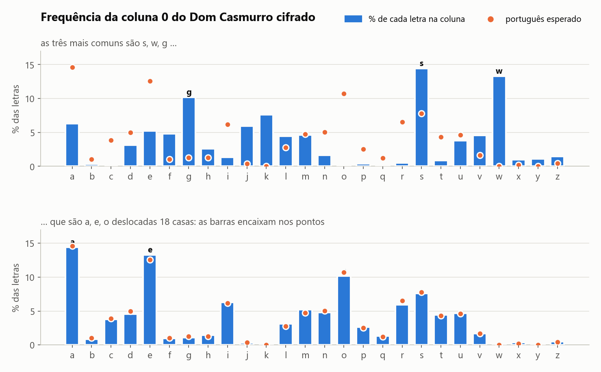

Em cima, as letras cifradas da coluna 0: os picos estão em `s`, `w` e `g`, onde o português não tem
pico nenhum. Embaixo, a mesma coluna **voltando 18 casas**: os picos caem sobre `a`, `e`, `o` e as
barras encaixam nos pontos laranja. Como 18 é a letra `s`, a primeira letra da senha é `s`.

### O χ² dos 26 deslocamentos, coluna por coluna

**Caso C: um vencedor claro em cada coluna.**

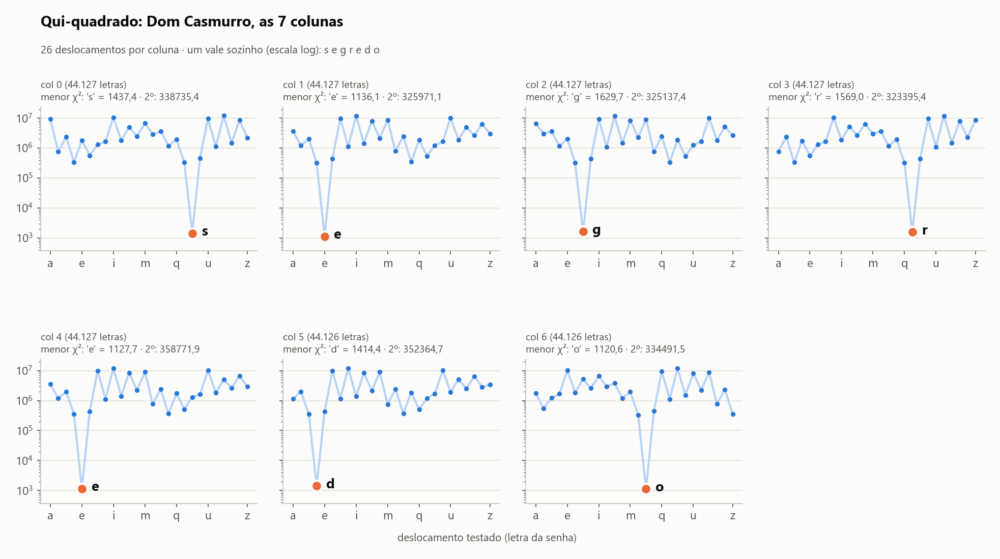

Em todas as colunas o deslocamento certo tem χ² entre 1 100 e 1 700, e o segundo colocado passa de
300 000 (o eixo é logarítmico). As sete letras formam **`segredo`**.

**Caso A: o mínimo existe, mas é por acaso.**

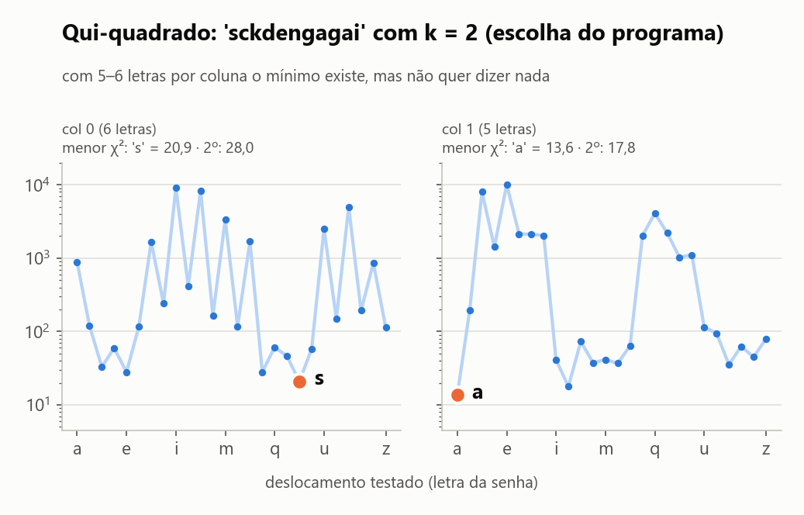

Com k = 2 (já errado na etapa 1) o programa encontra a senha `sa`. As curvas têm vários vales de
altura parecida (20,9 contra 28,0 na coluna 0), e qualquer um deles poderia ter vencido.

**Caso B: mesmo com o tamanho certo, não há como acertar.**

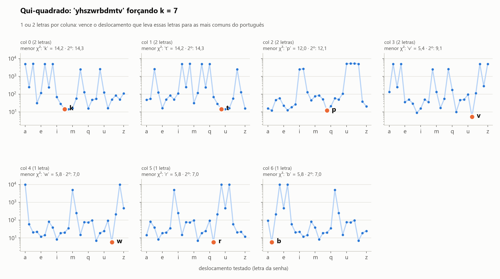

Aqui o tamanho foi forçado para 7 (`quebrar -t 7`), o valor correto. Mesmo assim, com 1 ou 2 letras
por coluna o χ² só consegue escolher o deslocamento que transforma essas poucas letras em letras
comuns do português. Nas colunas 0 e 1 o vencedor ganha por 14,2 contra 14,3, praticamente um empate.
A senha encontrada é `ktpvwrb`.

---

## 5. Resultado

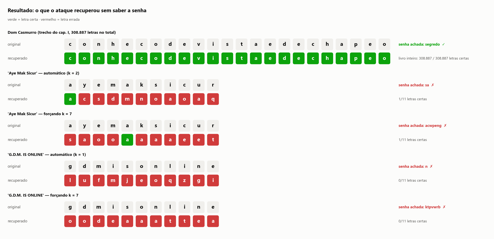

| Caso | Tamanho escolhido | Senha encontrada | Letras certas |
|---|---|---|---|
| C — *Dom Casmurro* | 7 | `segredo` ✔ | 308 887 / 308 887 |
| A — `Aye Mak Sicur` | 2 | `sa` ✘ | 1 / 11 |
| A — forçando `-t 7` | 7 | `acwpeng` ✘ | 1 / 11 |
| B — `G.D.M. IS ONLINE` | 1 | `n` ✘ | 0 / 11 |
| B — forçando `-t 7` | 7 | `ktpvwrb` ✘ | 0 / 11 |

A cifra e a decifra com a senha funcionam para qualquer tamanho de texto. A **quebra** é estatística
e precisa que a senha se repita muitas vezes: em *Dom Casmurro* ela se repete cerca de 44 mil vezes,
e nas frases curtas menos de duas. Por isso o ataque recupera o livro inteiro e falha nas duas frases,
mesmo quando recebe o tamanho certo da senha.

Os textos recuperados das frases curtas, como `saooaaaaeet`, ficam cheios de `a`, `e` e `o`. Isso
mostra o que o χ² faz quando não tem dados: escolhe os deslocamentos que produzem as letras mais
comuns do português, sem relação com a mensagem.

---

## Como gerar as imagens de novo

Na raiz do repositório:

```powershell
pip install matplotlib          # só para as imagens; o vigenere.py não precisa
python docs/gerar_imagens.py    # grava os PNGs em docs/img/
```
